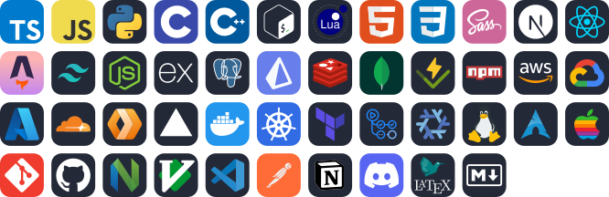

<picture>
  <source media="(prefers-color-scheme: dark)" srcset="resources/hero-dark.svg">
  <source media="(prefers-color-scheme: light)" srcset="resources/hero-light.svg">
  
</picture>

I'm Lakshay. I build AI products end to end at Skillion, mostly in TypeScript and Next.js, on Cloudflare, AWS and my own servers.

Most of what I ship lives in private repos, so here is the short version.

- [Reconexa](https://unlux.dev/projects/reconexa) reads insurer payment emails and reconciles clinic invoices in Cliniko and Xero. Two physiotherapy clinics run on it, and extraction accuracy went from 68% to 97.5%.
- [skillionailabs.com](https://skillionailabs.com) has an AI diagnostic, a chatbot and Lara, a voice agent you can talk to on the web or by phone.
- [SoundPrint](https://unlux.dev/projects/soundprint) turns your Spotify taste into generative art on the Internet Computer. It won first place at Hack the Block 2025 at LPU.

The pins below are small tools I made because something annoyed me. There is more at [unlux.dev](https://unlux.dev), where I also write sometimes.

Stuff I know... Maybe... Just maybe...

  <picture>
    <source media="(prefers-color-scheme: dark)" srcset="resources/skills-dark.svg">
    <source media="(prefers-color-scheme: light)" srcset="resources/skills-light.svg">
    
  </picture>

<!--
The banner is drawn by resources/banner.py. To change it, edit the script and run:
  python3 resources/banner.py resources

The skill tiles are saved copies of skillicons.dev, one per theme. To change them, edit the
list and save both themes over resources/skills-dark.svg and resources/skills-light.svg:
  https://skillicons.dev/icons?perline=12&theme=dark&i=ts,js,py,c,cpp,bash,lua,html,css,sass,nextjs,react,astro,tailwind,nodejs,express,postgres,prisma,redis,mongodb,vitest,npm,aws,gcp,azure,cloudflare,workers,vercel,docker,kubernetes,terraform,githubactions,nix,linux,arch,apple,git,github,neovim,vim,vscode,postman,notion,discord,latex,md
-->
